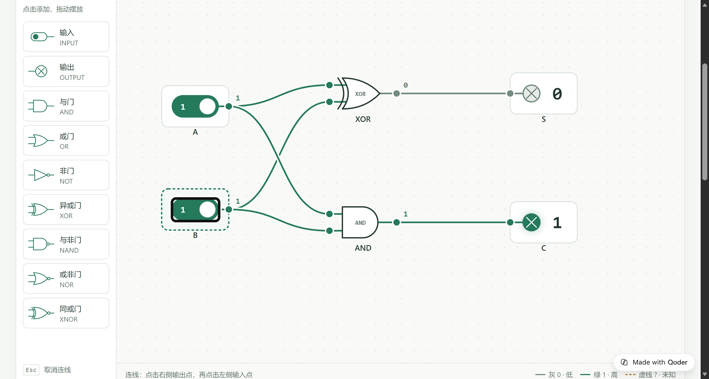
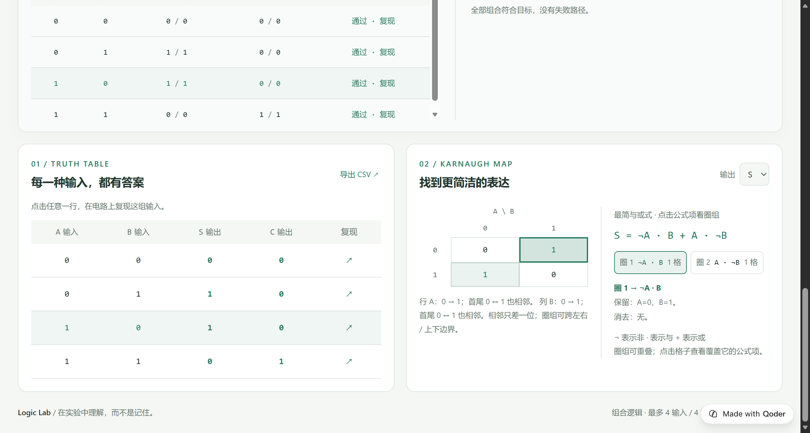

# Logic Campus Projects

两个跑在浏览器里、共用同一套仿真内核的数字逻辑作品：**Logic Lab 逻辑实验室**（实验助教方向）与 **Gate Quest 逻辑之光**（逻辑门解谜游戏）。两者均为 2026 Qoder 高校创造力大赛参赛作品（StudyHack / LifeHack 赛道），已部署在 Qoder Sites，公开、免登录、打开即用。

| 项目 | 赛道 | 在线体验 | 简介 |
| --- | --- | --- | --- |
| Logic Lab 逻辑实验室 | StudyHack | <https://logic-lab-19f6yxu4aix.qoder.website> | 自由搭电路的组合电路实验台：实时信号、目标检测、真值表 / 卡诺图讲解 |
| Gate Quest 逻辑之光 | LifeHack | <https://gate-quest-19f6yxu4aix.qoder.website> | 用逻辑门修好一座城市的信号网：关卡解谜、星级评价、进度本地存档 |

## 截图

### Logic Lab 逻辑实验室

半加器实时仿真：拨动输入开关，导线上的 0 / 1 跟着变。



真值表与卡诺图讲解：从电路直接生成，对照化简结果。



### Gate Quest 逻辑之光

关卡地图：城市信号网坏了一处，挑关卡去修。


通关结算：按使用元件数评星。


## 功能

**Logic Lab 逻辑实验室**

- 元件库含与、或、非、异或、与非、或非、同或七种门，最多 4 输入 4 输出，拖动摆放、点端口连线。
- 信号实时传播；未接端口显示为灰色问号（未知），不会被当成低电平误导结果。
- 内置半加器、多路选择器等实验，附目标真值表检测：接完自动对照题意判对错。
- 找错练习：给反例、复现错误输出、高亮待查路径，引导自己定位接错的线。
- 真值表、卡诺图、最简表达式讲解，随电路即时生成。

**Gate Quest 逻辑之光**

- 以城市信号网为故事线的关卡解谜：每关给出坏掉的信号与可用元件，接对即修好。
- 星级评价鼓励更省的接法；通关进度存于浏览器 localStorage，刷新不丢。
- 与 Logic Lab 共用仿真内核，门电路行为两边完全一致。

## 快速开始

无框架、无第三方依赖，只需 Node.js 18+。

```bash
git clone https://github.com/poki-cpu/logic-campus-projects.git
cd logic-campus-projects
npm test        # 74 项测试
npm run dev     # 本地预览服务
```

打开 <http://127.0.0.1:4173/logic-lab/web/> 或 <http://127.0.0.1:4173/gate-quest/web/>。

只预览某一个站点：`node scripts/serve.mjs gate-quest`（Logic Lab 默认端口 4173，Gate Quest 4174）。

构建部署产物：`npm run build`，输出到各站点的 `dist/`（构建产物不入库）。

## 项目结构

```
├── shared/            # 共用内核：仿真引擎 engine.mjs、电路编辑器 editor.mjs / editor.css
├── logic-lab/web/     # Logic Lab 源码（app.mjs、teaching.mjs 等）
├── gate-quest/web/    # Gate Quest 源码（levels.mjs 关卡、progress.mjs 存档等）
├── tests/             # node:test 测试，覆盖两个站点与共用内核
├── scripts/           # build.mjs 构建、serve.mjs 本地预览
└── docs/screenshots/  # README 截图
```

`shared/` 是唯一内核来源；`npm run build` 会把它同步进各站点的 `web/shared/` 再产出 `dist/`。

## 测试

```bash
npm test
```

74 项测试：门电路真值表、连线求值与未知信号、卡诺图化简、编辑器操作、教学内容、关卡判定与存档进度。

## 技术栈

原生 JavaScript（ES Modules）+ HTML/CSS，无框架、无构建依赖；测试用 Node.js 内置 `node:test`；线上部署使用 Qoder Sites。

## 许可证

[MIT](LICENSE) © poki-cpu